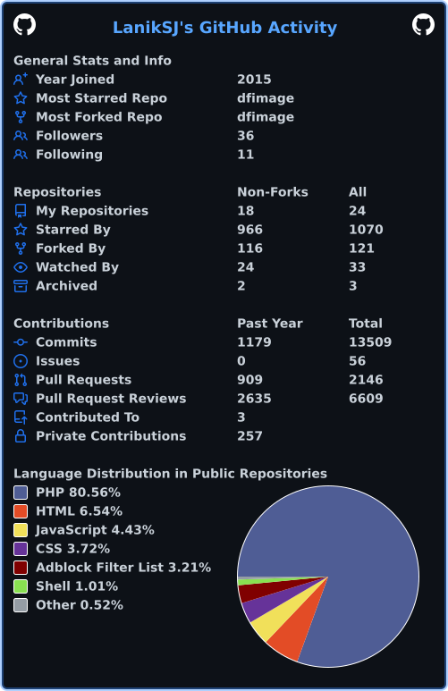

# Hi, I'm LanikSJ! 👋

## 👨‍💻 About Me

## ✨ Tagline

Passionate about open source and automation

## 🚀 DevOps Professional

### 🛠️ Top Skills

### 🐙 Most Notable Projects

- [awscli-aliases](https://github.com/LanikSJ/awscli-aliases) - Useful aliases for AWS CLI commands
- [dfimage](https://github.com/LanikSJ/dfimage) - Tool to reverse-engineer Docker images
- [lsusb](https://github.com/LanikSJ/lsusb) - Utility for listing USB devices
- [ubo-filters](https://github.com/LanikSJ/ubo-filters) - Filters for uBlock Origin
- [webannoyances](https://github.com/LanikSJ/webannoyances) - Filters for web annoyances

### 💡 Fun Fact

I speak 3 languages.

---

## ⚙️ Skills Automation

This repository maintains agent skills via `skills-lock.json`. The GitHub Actions
workflow automatically updates the skills monthly and creates a pull request.

- **Workflow**: `.github/workflows/skills-update.yml`
- **Schedule**: Monthly on the 5th at 06:00 UTC
- **Manual run**: `npx skills update`
